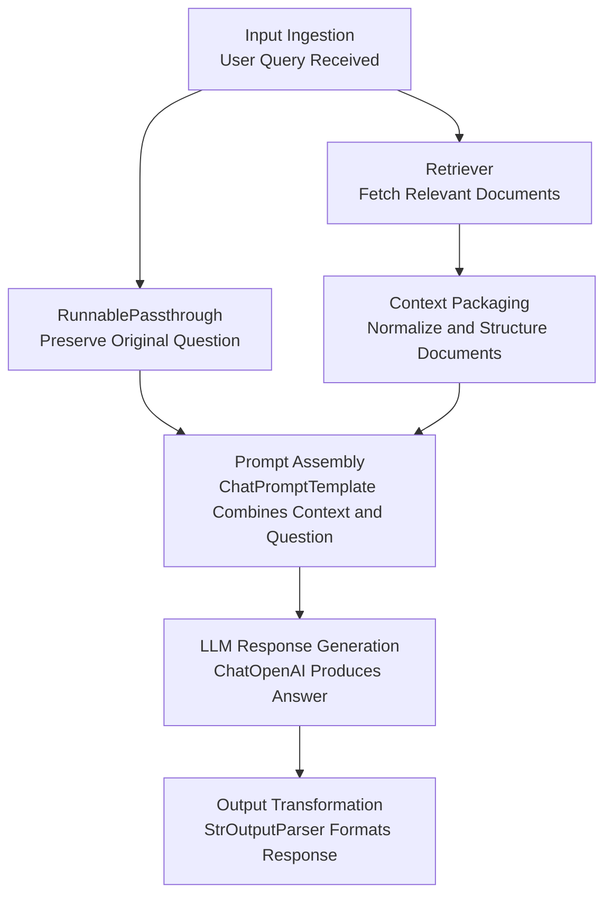

# RAG Examples for Cybersecurity

This directory provides a collection of Python scripts demonstrating various aspects of Retrieval-Augmented Generation (RAG) tailored for cybersecurity use cases. These examples cover fundamental RAG concepts such as document loading, text splitting, embedding generation, vector store creation, and querying, primarily using LangChain and OpenAI.

## Basic Examples Explained:



## Directory Structure

```
part4_rag_examples/
├── README.md                           # This documentation file
├── basic_rag_part1.py                  # Creates a Chroma vector store from ssrf.txt and llm_cheatsheet.md.
├── basic_rag_part2.py                  # Queries the vector store created by basic_rag_part1.py.
├── basic_rag_part3.py                  # Full RAG chain (retriever + prompt + LLM) over the same vector store.
├── data/                               # Contains raw data files for ingestion.
│   ├── llm_cheatsheet.md               # Markdown cheat sheet on LLM security.
│   ├── ssrf.txt                        # Text file about Server-Side Request Forgery.
│   ├── tesla.json                      # JSON file with Tesla-related data (e.g., for embedding/splitting demos).
│   └── tesla_hostnames.txt             # Text file listing Tesla-related hostnames.
├── db/                                 # Stores persisted Chroma vector databases.
│   ├── chroma_db_security/             # Committed. Vector store for basic_rag_part1/2/3.py.
│   ├── hacker_training/                # Committed. Vector store for web_scrape_basic.py (hackertraining.org).
│   ├── chroma_db_char/                 # Generated by text_splitting_deep_dive.py (character-based).
│   ├── chroma_db_custom/               # Generated by text_splitting_deep_dive.py (custom splitting).
│   ├── chroma_db_rec_char/             # Generated by text_splitting_deep_dive.py (recursive character-based).
│   ├── chroma_db_sent/                 # Generated by text_splitting_deep_dive.py (sentence-based).
│   ├── chroma_db_token/                # Generated by text_splitting_deep_dive.py (token-based).
│   ├── chroma_db_huggingface/          # Generated by embedding_deep_dive.py (Hugging Face embeddings).
│   └── chroma_db_openai/               # Generated by embedding_deep_dive.py (OpenAI embeddings).
├── embedding_deep_dive.py              # Demonstrates using different embedding models (OpenAI, Hugging Face).
├── text_splitting_deep_dive.py         # Explores various text splitting techniques.
├── utils/                              # Utility scripts.
│   └── embedding_cost_calculator.py    # Calculates the estimated cost of embedding a document using OpenAI.
└── web_scrape_basic.py                 # Scrapes a web page, creates embeddings, and stores them in a vector store.
```

## File Descriptions

### Core Scripts

-   **`basic_rag_part1.py`**
    -   **Purpose**: Demonstrates the creation of a Chroma vector store from multiple documents (`data/ssrf.txt` and `data/llm_cheatsheet.md`).
    -   **Functionality**: Loads each file with `TextLoader` or `UnstructuredMarkdownLoader` (each chunk keeps its `source` metadata), splits it into chunks using `CharacterTextSplitter`, generates embeddings with `OpenAIEmbeddings` (model `text-embedding-3-small`), and persists the vector store to `db/chroma_db_security`.
    -   Checks if the store exists before initialization.

-   **`basic_rag_part2.py`**
    -   **Purpose**: Shows how to query an existing Chroma vector store (created by `basic_rag_part1.py`).
    -   **Functionality**: Loads the vector store from `db/chroma_db_security`, uses `OpenAIEmbeddings` for the query, and retrieves relevant documents based on a similarity score threshold.

-   **`basic_rag_part3.py`**
    -   **Purpose**: Puts it all together with a complete RAG chain built with LCEL.
    -   **Functionality**: Retrieves context from `db/chroma_db_security`, combines it with the question in a `ChatPromptTemplate`, and answers with `ChatOpenAI` (`gpt-6-luna`).

-   **`embedding_deep_dive.py`**
    -   **Purpose**: Compares different embedding models (OpenAI's `text-embedding-ada-002` and Hugging Face's `sentence-transformers/all-mpnet-base-v2`).
    -   **Functionality**: Loads data from `data/tesla.json`, creates separate Chroma vector stores (`db/chroma_db_openai` and `db/chroma_db_huggingface`) for each embedding type, and queries both to compare results.

-   **`text_splitting_deep_dive.py`**
    -   **Purpose**: Explores and compares various text splitting strategies available in LangChain.
    -   **Functionality**: Uses `data/tesla.json` and applies `CharacterTextSplitter`, `SentenceTransformersTokenTextSplitter`, `TokenTextSplitter`, `RecursiveCharacterTextSplitter`, and a custom splitter. Each strategy creates its own vector store (e.g., `db/chroma_db_char`, `db/chroma_db_sent`, etc.) and is then queried.

-   **`web_scrape_basic.py`**
    -   **Purpose**: Shows how to scrape content from a web page, process it, and store it in a vector database for RAG.
    -   **Functionality**: Uses `WebBaseLoader` to fetch content from `https://hackertraining.org`, splits it, creates embeddings (`text-embedding-3-small`), and persists to `db/hacker_training`. It then queries this store and answers with a RAG chain.

### Utility Scripts

-   **`utils/embedding_cost_calculator.py`**
    -   **Purpose**: Provides an estimation of the cost to embed a given text file using OpenAI's API.
    -   **Functionality**: Reads `data/ssrf.txt`, tokenizes it using `tiktoken` (with `cl100k_base` encoding), and calculates the cost based on a predefined rate (e.g., $0.02 per million tokens for `text-embedding-3-small`).

### Data Directory (`data/`)

This directory holds the source documents used by the example scripts:
-   `ssrf.txt`: Contains textual information about Server-Side Request Forgery vulnerabilities, used by `basic_rag_part1.py` and `embedding_cost_calculator.py`.
-   `llm_cheatsheet.md`: A Markdown cheat sheet on LLM security, loaded by `basic_rag_part1.py` alongside `ssrf.txt`.
-   `tesla.json`: A JSON file with data related to Tesla, used as a larger document for `embedding_deep_dive.py` and `text_splitting_deep_dive.py` to demonstrate embeddings and splitting on more extensive content.
-   `tesla_hostnames.txt`: A list of Tesla-related hostnames, available as extra sample data.

### Database Directory (`db/`)

This directory is where Chroma vector stores are persisted by the scripts. Each subdirectory corresponds to a vector store created by a specific script or with a particular configuration:
-   `chroma_db_security/` (committed): Created by `basic_rag_part1.py` from `ssrf.txt` and `llm_cheatsheet.md`. Also used by `part5_agents_and_mcp_servers/agent_deep_dive/agent_docstore.py`.
-   `hacker_training/` (committed): Created by `web_scrape_basic.py` from the content of `hackertraining.org`.
-   `chroma_db_char/`, `chroma_db_custom/`, `chroma_db_rec_char/`, `chroma_db_sent/`, `chroma_db_token/`: Created by `text_splitting_deep_dive.py`, each using a different text splitting method on `tesla.json`.
-   `chroma_db_huggingface/`, `chroma_db_openai/`: Created by `embedding_deep_dive.py`, using Hugging Face and OpenAI embeddings respectively on `tesla.json`.

## Prerequisites

-   Python 3.13+ and [uv](https://docs.astral.sh/uv/)
-   An OpenAI API key, set as an environment variable `OPENAI_API_KEY`.

## Getting Started

1.  **Clone the repository** (if you haven't already).
2.  **Install dependencies** from the repository root:
    ```bash
    uv sync --python python3.13
    ```
3.  **Set up your OpenAI API Key**: Export it as an environment variable.
    ```bash
    export OPENAI_API_KEY='your-actual-openai-api-key'
    ```
    Alternatively, create a `.env` file in the `part4_rag_examples` directory with the line `OPENAI_API_KEY='your-actual-openai-api-key'` (scripts using `load_dotenv()` will pick it up).

    **SECURITY NOTE**: Never commit your API keys to version control. Also, instead of using environment variables to store sensitive information, you can use a secrets management service like CyberArk Conjur, HashiCorp Vault or AWS Secrets Manager.

4.  **Run the example scripts**: Start with the basic examples:
    -   To create an initial vector store:
        ```bash
        python basic_rag_part1.py
        ```
    -   To query the store created above:
        ```bash
        python basic_rag_part2.py
        ```
    Explore other scripts to understand different RAG aspects.

## Key Concepts Demonstrated

-   **Document Loading**: Using `TextLoader`, `WebBaseLoader` to ingest data from files and web pages.
-   **Text Splitting**: Employing various strategies like `CharacterTextSplitter`, `RecursiveCharacterTextSplitter`, `SentenceTransformersTokenTextSplitter`, `TokenTextSplitter`, and custom splitters to break down documents into manageable chunks.
-   **Embeddings**: Generating numerical representations of text using `OpenAIEmbeddings` (e.g., `text-embedding-3-small`, `text-embedding-ada-002`) and Hugging Face models (`sentence-transformers/all-mpnet-base-v2`).
-   **Vector Stores**: Using `Chroma` as a vector database to store embeddings and perform similarity searches.
-   **Persistence**: Saving and loading vector stores to/from disk.
-   **Retrieval**: Querying vector stores to find relevant document chunks based on semantic similarity to a user's question, using techniques like similarity score thresholds.
-   **Metadata**: Attaching and utilizing metadata (like document source) during RAG.
-   **Question Answering**: Combining retrieved documents with a query to generate answers using an LLM (`ChatOpenAI`).
-   **Cost Estimation**: Using `tiktoken` to estimate token count and potential costs for OpenAI embeddings.

## Notes

-   Most scripts are designed to be run independently, but some (like `_part2.py` scripts) depend on vector stores created by their `_part1.py` counterparts.
-   The `db/` directory will be populated as you run the scripts that create persistent vector stores.
-   Ensure your OpenAI API key has sufficient quota/billing set up if you plan to run these scripts multiple times, especially `embedding_deep_dive.py` or `text_splitting_deep_dive.py` which process larger data or create multiple stores.

   ```bash
   python text_splitting_deep_dive.py
   ```

## Query Example

The script includes a sample query:
```python
query = "What hosts are in Amazon?"
```

This query is executed against all five vector stores, allowing you to compare how different splitting methods affect retrieval results.

## Configuration

- Embedding model: text-embedding-3-small
- Similarity score threshold: 0.1
- Results per query: 1 document
- Search type: similarity_score_threshold

---

# Web Scraping RAG Example

This script demonstrates how to create a RAG (Retrieval-Augmented Generation) system that scrapes web content, processes it, and stores it in a vector database for semantic search capabilities.

## Overview

The script performs the following operations:
1. Scrapes content from specified web pages using WebBaseLoader
2. Splits the content into manageable chunks
3. Creates embeddings using OpenAI's embedding model
4. Stores the embeddings in a Chroma vector database
5. Performs semantic search queries on the stored content

## Prerequisites

- Python 3.x
- Dependencies installed with `uv sync` (see Getting Started above)
- OpenAI API key set in your `.env` file

## Project Structure

```
part4_rag_examples/
├── web_scrape_basic.py
└── db/
    └── hacker_training/  # Directory where the vector store is persisted
```

## Features

- **Web Scraping**: Automatically extracts content from specified URLs
- **Content Processing**: 
  - Splits content into 1000-character chunks
  - 50-character overlap between chunks
- **Vector Storage**:
  - Persistent Chroma database
  - Automatic initialization check
  - Source URL metadata preservation
- **Semantic Search**:
  - Similarity-based retrieval
  - Returns top 3 most relevant results
  - Includes source metadata in results

## Usage

1. Create a `.env` file with your OpenAI API key:
   ```
   OPENAI_API_KEY=your-api-key-here
   ```

2. Modify the `urls` list to include your target websites:
   ```python
   urls = ["https://hackertraining.org"]
   ```

3. Run the script:
   ```bash
   python web_scrape_basic.py
   ```

## Configuration

- Embedding model: text-embedding-3-small
- Chunk size: 1000 characters
- Search results: Top 3 most relevant documents
- Search type: similarity

## Example Query

The script includes a sample query:
```python
query = "What is hackertraining.org all about?"
```

## Output

The script provides:
- Number of document chunks created
- Sample of processed content
- Vector store creation status
- Relevant documents for the query with their sources

## Author

Instructor: Omar Santos (@santosomar)
