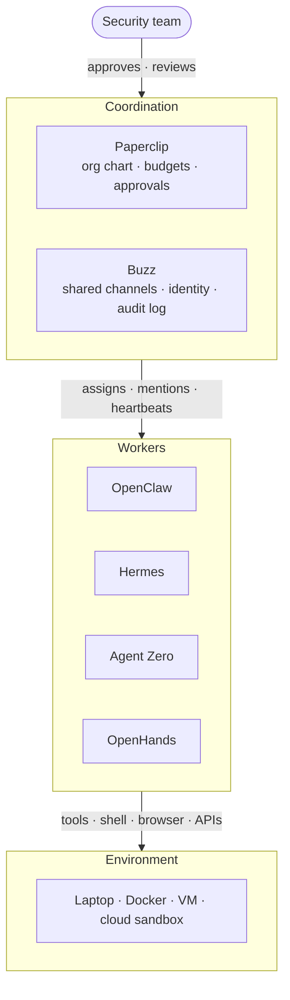

# Part 6: Agentic Frameworks for Security Teams

Parts 1–5 of this repository show how to *build* agents from primitives (LangChain, LangGraph, CrewAI, MCP). Part 6 looks at six popular, ready-made agentic frameworks and asks three questions about each one:

1. **What is it?**
2. **Where does it help a security team?**
3. **Where should it stay out?**

## The six at a glance

| Agent | What it is | From | Where it runs |
|-------|-----------|------|---------------|
| [OpenClaw](openclaw/) | A personal assistant you message in your chat apps | Peter Steinberger; now the OpenClaw Foundation | A gateway on your own machine |
| [Hermes](hermes/) | A self-improving agent that saves workflows as skills | Nous Research | Your host, a container, or a cloud sandbox |
| [Agent Zero](agent_zero/) | A general-purpose agent with its own Linux computer | agent0ai community | A Docker container (Kali Linux) |
| [OpenHands](openhands/) | An autonomous software engineer: issue in, pull request out | OpenHands (formerly OpenDevin) | A Docker sandbox, or its cloud |
| [Paperclip](paperclip/) | A control plane for a "company" of agents | paperclipai | Laptop, Docker, or server |
| [Buzz](buzz/) | A shared workspace for people and agents | Block | A relay you host yourself |

## Side-by-side comparison

| | OpenClaw | Hermes | Agent Zero | OpenHands | Paperclip | Buzz |
|---|---|---|---|---|---|---|
| **Layer** | Worker | Worker | Worker | Worker | Coordination | Coordination |
| **License** | MIT | Open source | Open source | MIT core + commercial cloud | Open source | Apache-2.0 |
| **Sandbox by default?** | No (off by default) | Only with a container or remote backend | Yes (the container is the boundary) | Yes (Docker/VM backends) | Not a sandbox; workers run elsewhere | Not a sandbox; agents run elsewhere |
| **Human-in-the-loop** | Execution approvals (opt-in) | Command approval; skills auto-written without review | Manual | Security analyzers + `ConfirmRisky` policy | Board approvals, budgets, kill switch | Membership + human merge sign-off |
| **Extensibility** | `SKILL.md`, ClawHub, plugins, MCP | `SKILL.md` (agentskills.io), Skills Hub, MCP | Skills, plugin hub, MCP | Python SDK, Agent Server | Adapter plugins, HTTP/webhook agents | Any ACP agent |
| **Persistence** | `SOUL.md`, `MEMORY.md`, `HEARTBEAT.md` | Skills + session search + user model | Long-term memory, Time Travel snapshots | Event-sourced history | Tasks, goals, audit log | Signed Nostr events, hash-chained audit log |
| **Best security fit** | Personal on-call lookups | Turning runbooks into reviewable skills | Disposable pentest/CTF lab | Vulnerability backlog → draft PRs | Governing and capping an agent fleet | Incident war rooms with attributed agents |

## Which one for which job?

| If you want to… | Start with | Watch out for |
|---|---|---|
| Ask an assistant about alerts and CVEs from your phone | OpenClaw | One-operator trust model; malicious ClawHub skills |
| Capture a senior analyst's triage steps as runbooks | Hermes | Skills learned from attacker-controlled input |
| Practice authorized recon and exploitation in a lab | Agent Zero | Host mounts, Docker socket, flat networks |
| Burn down Dependabot and SAST findings | OpenHands | Issue text as prompt injection; over-scoped CI tokens |
| See and cap what a fleet of agents is doing and spending | Paperclip | `local_trusted` mode exposed beyond loopback |
| Run an incident channel where humans and agents collaborate | Buzz | Agents reading every message in every channel they join |

## How they relate

These are not six competitors. They sit at different layers of the stack:



- **Worker agents** (OpenClaw, Hermes, Agent Zero, OpenHands) take actions: run shell commands, browse, write code, send messages.
- **Coordination layers** (Paperclip, Buzz) do not do the work themselves. They decide who works on what, keep a record, and put humans in the loop.

### Example: a "virtual SOC" stack

One way to combine them in a lab, with each layer adding a control the others lack:

1. **Buzz** hosts an incident channel. Every message is signed, so you can tell which human or agent said what.
2. **Paperclip** owns the org chart: a triage agent, an enrichment agent, and a reporting agent, each with a token budget and a human "board" that approves new hires.
3. **OpenHands** turns confirmed findings into draft fix PRs that still go through branch protection and human review.
4. **Agent Zero** runs in an isolated lab network to reproduce or validate a finding.
5. **Your SIEM** receives the Paperclip activity log and the Buzz audit events, so the record lives outside every agent's reach.

## Shared building blocks

The same open standards keep showing up across these frameworks. Learning them once pays off everywhere.

| Building block | What it is | Used by |
|---|---|---|
| **Agent Skills (`SKILL.md`)** | Markdown instructions + scripts the agent loads on demand ([agentskills.io](https://agentskills.io)) | OpenClaw, Hermes, Agent Zero |
| **MCP** | Model Context Protocol: a standard way to expose tools and data to agents (see Part 5) | OpenClaw, Hermes, Agent Zero, Paperclip |
| **ACP** | Agent Client Protocol: a standard way to plug a coding agent (Claude Code, Codex, goose) into a host app | Buzz |
| **Heartbeats / cron** | Scheduled wake-ups so agents act without being prompted | OpenClaw, Hermes, Paperclip |
| **Sub-agents** | A lead agent delegates to child agents with narrower context | Hermes, Agent Zero, Paperclip (org chart) |
| **Signed identity** | Per-agent keys or credentials so actions are attributable | Paperclip (per-agent keys/JWTs), Buzz (Nostr keypairs, NIP-OA delegation) |

The security takeaway: skills, MCP servers, and plugins are **code you are running**, not documentation you are reading. Review them like any third-party dependency.

## Shared risks across all six

Every framework in this part gives an LLM the ability to act. The same threat classes show up in all of them:

| Risk | What it looks like |
|------|-------------------|
| Indirect prompt injection | A web page, email, issue comment, or chat message contains instructions the agent follows as if they came from you |
| Skill / plugin supply chain | Community "skills" or plugins run arbitrary code. ClawHub audits in 2026 found hundreds of malicious skills |
| Persistent memory poisoning | Memory files, learned skills, or identity files (`SOUL.md`, `MEMORY.md`) get rewritten so the agent misbehaves in *future* sessions |
| Over-broad credentials | The agent holds tokens for email, GitHub, cloud, or chat, so one bad action can reach everything those tokens reach |
| Exposed control surfaces | Web UIs and gateways bound to `0.0.0.0` or tunneled to the internet without authentication |
| Approval fatigue / fail-open defaults | Confirmation prompts disabled for convenience; non-interactive modes that auto-approve |
| Denial of wallet | A looping or hijacked agent burns through API spend (see Part 7 for budgets and loop ceilings) |

The [OWASP Top 10 for Agentic Applications](https://genai.owasp.org/) and the CodeGuard rules in `.cursor/rules/` are good companions to this part.

## 2026 in real incidents

These aren't hypothetical risks. Each sub-folder documents real advisories and research; here are the highlights:

| Framework | Incident | Lesson |
|---|---|---|
| OpenClaw | CVE-2026-25253: a crafted `gatewayUrl` leaked the gateway token and chained to command execution | Never expose the gateway; keep approvals on |
| OpenClaw | "ClawHavoc" (Koi Security): 341 malicious skills out of 2,857, later 824+; Snyk ToxicSkills found critical issues in 13.4% of skills | Skill marketplaces are a software supply chain |
| Hermes | Skills Guard regex scanner bypassed with dynamic imports to exfiltrate environment variables | Scanners are speed bumps; read the code |
| Hermes | Batch and cron paths auto-approved dangerous commands (since fixed) | Unattended mode + untrusted input = no human watching |
| Agent Zero | CVE-2026-30624: remote code execution through attacker-supplied MCP server configs | MCP configs are code execution |
| Agent Zero | Plaintext secrets in the system prompt (issue #1107) and API keys in error logs (issue #1071) | Assume secrets reach the model provider's logs |

## Lab exercises

Good starting points for a training session or self-study. Run all of them in an isolated VM or container.

1. **Indirect prompt injection.** Put hidden instructions in a web page or issue comment, then ask OpenClaw or OpenHands to summarize it. Did the agent follow them? Which control would have stopped it?
2. **Skill supply chain.** Write a harmless "malicious" Hermes or OpenClaw skill that reads an environment variable at import time. Does the built-in scanner catch it? What about a dynamic import?
3. **Persistent memory poisoning.** Feed Hermes a session containing attacker-controlled text and inspect the skill it writes afterward.
4. **Defense in depth.** Configure OpenHands with `EnsembleSecurityAnalyzer` + `ConfirmRisky`, then compare which risky commands each analyzer flags on its own.
5. **Blast radius.** Give a Paperclip worker a budget and a deliberately looping task. Confirm the 80% warning and the 100% hard stop.
6. **Provenance.** In Buzz, have an agent post on behalf of a delegating human, then revoke the delegation and verify what still verifies.

## A rule of thumb

> The only real security boundary for an agent is the operating system and network around it. Approval prompts, regex scanners, and "safety" system prompts are helpful speed bumps, not walls.

Hermes Agent states this explicitly in its own `SECURITY.md`, and it applies equally to the other five frameworks. Run them in containers or VMs, give them the narrowest credentials that work, keep them off production by default, and log everything.

### Universal hardening baseline

Whatever framework you pick, start here, then apply the framework-specific checklist in its folder:

- [ ] Run in a container or VM on an isolated network with egress filtering
- [ ] Bind web UIs and gateways to `127.0.0.1`; put anything remote behind TLS and authentication
- [ ] Use dedicated, least-privilege, short-lived credentials with spend limits; never your daily-driver identity
- [ ] Keep approvals on for anything that writes, deletes, sends, or deploys
- [ ] Review every third-party skill, plugin, and MCP server before install; pin versions
- [ ] Version-control memory and skill files and diff them for unexpected changes
- [ ] Ship logs and audit events to a store the agent cannot modify

## Directory layout

```
part6_agentic_frameworks/
├── README.md        ← this file
├── openclaw/        ← personal chat-app assistant
├── hermes/          ← self-improving agent with skills
├── agent_zero/      ← agent with its own Kali Linux container
├── openhands/       ← autonomous software engineer
├── paperclip/       ← control plane for a company of agents
└── buzz/            ← shared human + agent workspace on Nostr
```

Each sub-directory has a `README.md` with the same structure: what it is, where it helps a security team, where it should stay out, a hardening checklist, and sources.

> **Note:** These projects move fast. Facts were researched in October 2026; check each project's docs and security advisories before deploying.
