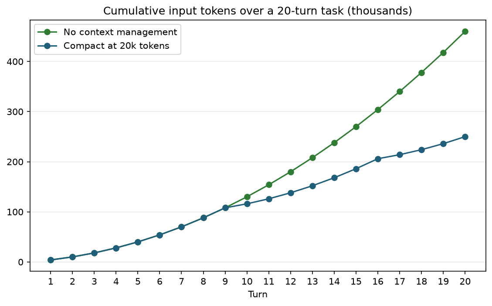

# 2. Context Compounding and Compaction

## Stateless APIs re-send everything

A model API does not remember the previous call. To continue a conversation, the agent framework sends **everything again**: the system prompt, every tool schema, every earlier message, and every tool result so far, followed by the new content.

A typical tool loop looks like this:

| Call | Re-sent context | New tokens | Total input | Re-sent share |
|-----:|---------------:|-----------:|------------:|-------------:|
| 1 | 0 | 7,000 | 7,000 | 0% |
| 2 | 7,000 | 3,000 | 10,000 | 70% |
| 3 | 10,000 | 3,000 | 13,000 | 77% |
| 4 | 13,000 | 4,000 | 17,000 | **76%** |

By the fourth call, three quarters of what you pay for is context the model has already processed.

## Why the total grows with the square of task length

If each turn adds a roughly constant `d` tokens to a base of `b`, then call *n* sends `b + (n−1)·d` tokens. The cumulative input over *N* turns is:

\[
\text{total input} = N \cdot b + d \cdot \frac{N(N-1)}{2}
\]

The second term is quadratic in *N*. Doubling the number of turns roughly quadruples the bill. With `b = 4k`, `d = 2k`, and `N = 20`:

\[
20 \cdot 4\text{k} + 2\text{k} \cdot \frac{20 \cdot 19}{2} = 80\text{k} + 380\text{k} = 460\text{k tokens}
\]

The constant system prompt is only 80k of the 460k total. The history is the other 380k.



## Compaction bends the curve

**Compaction** replaces old turns with a short summary once the context passes a threshold. In the chart above, whenever the context would exceed 20k tokens, history is summarized so the context drops back to 8k (4k base + 4k summary). Cumulative input falls from 460k to **250k**, 46% fewer tokens, and the gap widens with every extra turn.

Run `01_context_growth.py` to reproduce this and to try other thresholds:

```bash
uv run python part7_tokenomics/01_context_growth.py --turns 40 --compact-at 30000 --compact-to 10000 --plot
```

## Compaction techniques, cheapest first

1. **Don't let it in.** Summarize or filter tool output *before* it enters the context. A 6,500-token nmap scan becomes a 175-token list of open services (see `06_tool_schema_overhead.py`). This is the highest-leverage technique because the savings repeat on every later call.
2. **Clear old tool results.** After the agent has acted on a tool result, the raw result is rarely needed again. Replace it with a placeholder such as `[cleared: splunk_search returned 412 events, see artifact 7]`.
3. **Summarize old turns.** When the context passes a threshold, ask a cheap model to summarize the history into intent, findings, artifacts, and next steps, then keep only the last few messages verbatim.
4. **Offload to files or memory.** Write large intermediate results to a virtual filesystem or a store, and give the agent a tool to read them back on demand. The DeepAgents SOC example in `part5_agents_and_mcp_servers/deepagents_example/` uses this pattern.
5. **Split into subagents.** A subagent works in its own context and returns only its conclusion to the supervisor. The supervisor never pays for the subagent's tool noise.

LangChain 1.x ships middleware for the second and third techniques:

```python
from langchain.agents import create_agent
from langchain.agents.middleware import (
    ClearToolUsesEdit,
    ContextEditingMiddleware,
    SummarizationMiddleware,
)

agent = create_agent(
    model="openai:gpt-6.1-sol",
    tools=[splunk_search, whois_lookup, nvd_cve_lookup],
    middleware=[
        # Replace old tool outputs with "[cleared]" once context passes 30k tokens; keep the last 3.
        ContextEditingMiddleware(edits=[ClearToolUsesEdit(trigger=30_000, keep=3)]),
        # Summarize history with a cheap model once it passes 20k tokens; keep the last 6 messages.
        SummarizationMiddleware(model="openai:gpt-6-luna", trigger=("tokens", 20_000), keep=("messages", 6)),
    ],
)
```

## Compaction has costs too

- **The summary call is not free.** On short tasks, the summarization call can cost more than it saves. Compaction pays off on long tasks, where the quadratic term dominates.
- **Compaction breaks the cache.** Rewriting history changes the prefix, so the next call is a cache miss and a fresh cache write. Compact rarely and in large steps rather than a little every turn. Keep the system prompt and tool schemas *above* the compacted region so they stay cached.
- **Summaries lose detail.** An agent that forgets it already ran a scan will run it again. Good summaries keep a list of actions taken and artifacts produced; LangChain's default summary prompt has explicit `ARTIFACTS` and `NEXT STEPS` sections for this reason.

## Security considerations

- **Evidence integrity.** In an investigation, the raw tool output is evidence. Store it outside the context (a case-management system, object storage, or Splunk itself), and put only a summary plus a pointer in the context. Never let compaction be the only copy.
- **Summaries can launder prompt injection.** If an attacker-controlled log line says "ignore previous instructions", a summarizer may restate it as a fact or an instruction. Summarize with a prompt that treats tool output strictly as data, and keep summaries structured (fields, not prose) where you can.
- **Compaction resets memory of constraints.** If scope limits ("only scan 10.10.0.0/24") live in the history instead of the system prompt, they can be summarized away. Put authorization scope and safety rules in the system prompt, which is never compacted.

## Sources

- Splunk, *What is Agent Tokenomics?*: <https://www.splunk.com/en_us/blog/artificial-intelligence/what-is-agent-tokenomics.html>
- LangChain middleware reference: <https://docs.langchain.com/oss/python/langchain/middleware>
