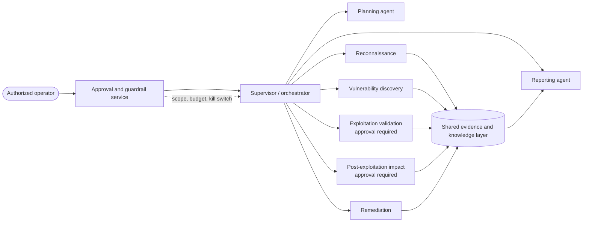

# Part 8: Multi-Agent Security-Assessment Harness Specification

> [!WARNING]
> This is a **design specification**, not a scanner or autonomous attack tool. It is for authorized red/purple-team education in explicitly approved, isolated lab environments. The exploitation and post-exploitation roles are disabled by default and require a recorded human approval for every execution.

This part describes a vendor-neutral harness for coordinating specialist agents through an authorized security-assessment lifecycle. It is inspired by Cisco DevNet's [Foundry Security Spec](https://github.com/CiscoDevNet/foundry-security-spec): architecture, invariants, evidence, and safety controls are the deliverable—not runnable code.

## Why a harness?

An LLM is useful at focused analysis, but a security assessment needs durable scope, bounded tools, reviewable evidence, and a reliable stop condition. This design uses a **supervisor + planner + narrow workers**: the supervisor owns policy and state transitions; workers own one bounded responsibility; a human authorizes material-risk actions.

## Pipeline at a glance

| Phase | Purpose | Default authority |
|---|---|---|
| [Reconnaissance](01-reconnaissance.md) | Inventory only approved lab attack surface | Read-only, bounded |
| [Vulnerability discovery](02-vulnerability-discovery.md) | Correlate evidence into candidate findings | Read-only, bounded |
| [Exploitation validation](03-exploitation-validation.md) | Validate a specific finding with a harmless, approved proof | Human-gated |
| [Post-exploitation impact](04-post-exploitation-impact.md) | Assess limited, simulated impact and detection coverage | Human-gated |
| [Remediation](05-remediation.md) | Produce prioritized, reviewable mitigations | Recommendation-only |

The [architecture specification](architecture.md) defines contracts and state. The [safety and rules-of-engagement specification](safety-governance.md) defines the non-negotiable control plane. [`agents.yaml`](agents.yaml) is the machine-readable reference configuration; [`references.md`](references.md) records the research base.

## Relationship to the rest of this repository

- **Part 5** supplies the learning primitives: LangGraph shared-state workflows, the simulated attack-surface-management pipeline, CrewAI, DeepAgents, and MCP examples. This spec makes their boundaries and approvals explicit.
- **Part 6** compares ready-made worker and coordination frameworks. Its central lesson applies here: containers, network segmentation, and identity are the boundary; prompts and approvals are additional controls.
- **Part 7** supplies the token/cost discipline. Every run has per-agent token, cost, tool-call, retry, and elapsed-time ceilings to defend against loops and denial-of-wallet.

## Reading order

1. Start with [safety-governance.md](safety-governance.md); no implementation decision overrides it.
2. Read [architecture.md](architecture.md) and [`agents.yaml`](agents.yaml).
3. Read the five phase specifications in pipeline order.
4. Use [references.md](references.md) to validate fast-moving framework and protocol details before implementation.

> [!NOTE]
> Frameworks and standards change quickly. Research for this specification was performed in **October 2026**. Confirm current protocol versions, security advisories, and organizational policy before implementing or connecting any real tool.

## Out of scope

- Operational exploit code, payloads, credential harvesting, persistence, evasion, or lateral-movement instructions
- Internet-wide discovery, production testing, or unapproved targets
- Unattended high-impact actions
- A dependency, executable, or service implementation

