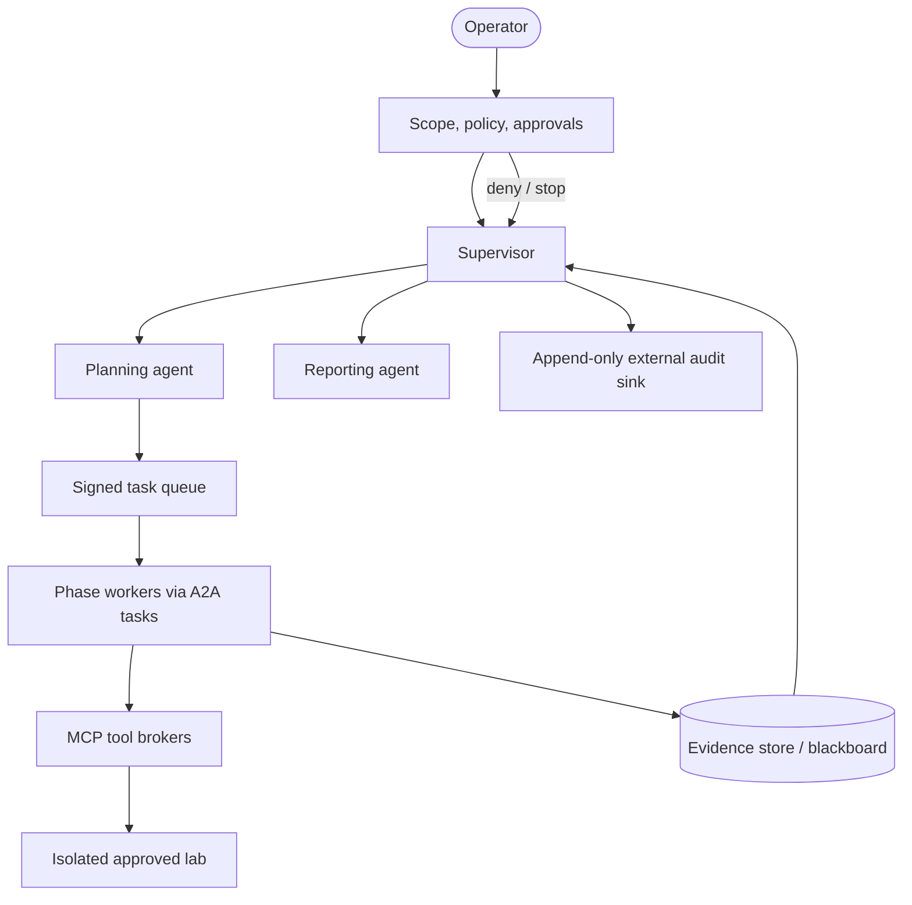

# Architecture and Orchestration Specification

This document defines the control plane for the [Part 8 harness](README.md). It adopts MCP-style, schema-described tools and A2A-style, typed inter-agent messages. An implementation may use LangGraph, CrewAI, AutoGen, OpenAI Agents SDK, or Microsoft Agent Framework, but **must preserve these contracts and gates**.

## Pattern selection

| Pattern | Use in this harness | Constraint |
|---|---|---|
| Supervisor/worker | Primary: supervisor retains lifecycle ownership | Workers cannot grant themselves authority |
| Planner/executor | Planner produces a reviewable plan; workers execute approved tasks | Plans are not permissions |
| Blackboard | Shared evidence store joins durable facts, findings, approvals, and audit events | Untrusted retrieved text is labeled, not instruction |
| Hierarchical | Useful adapter for CrewAI/OpenAI handoffs/Magentic orchestration | Routing remains policy-enforced |



## Roles and authority

| Role | May do | Must not do |
|---|---|---|
| Supervisor | Validate policy, select eligible worker, enforce budgets, pause/stop, publish state transitions | Directly invoke high-impact tools or bypass approval |
| Planner | Decompose objective into typed, reversible tasks and dependencies | Expand scope or authorize execution |
| Phase worker | Produce evidence-bound output using its allowlisted capabilities | Call tools outside its phase/scope |
| Guardrail / HITL | Verify approver identity, issue short-lived signed approval, revoke/kill | Delegate approval to an agent |
| Reporter | Convert accepted evidence into a report | Infer evidence or change finding state |
| Memory layer | Retain provenance, redaction class, versioned artifacts | Execute retrieved content as instructions |

## State model

`assessment` is immutable at creation except for an operator-approved amendment. `task` moves:

`proposed → policy_checked → approved → running → evidence_submitted → reviewed → complete`

Terminal states are `rejected`, `blocked`, `aborted`, and `expired`. A task that needs a gated capability remains `approval_pending`; it cannot enter `running` from a worker decision.

### Required shared records

| Record | Minimum fields | Writer |
|---|---|---|
| Scope manifest | assessment ID, target IDs, allowed capabilities, expiry, exclusions, lab attestation | Operator |
| Task | ID, parent, phase, signed scope reference, budget, input artifact references | Planner/Supervisor |
| Evidence | content hash, source/tool, time, scope reference, sensitivity class, redaction status | Worker/tool broker |
| Finding | fingerprint, affected asset, evidence references, confidence, status | Discovery/validation reviewer |
| Approval | approver identity, action digest, target, expiry, single-use nonce, decision | HITL |
| Audit event | actor, action, outcome, policy decision, correlation ID | Every control-plane component |

Treat tool output, webpages, scanner text, and memory as untrusted data: they may contain indirect prompt injection. Preserve them as quoted evidence, never as control instructions.

## A2A-like worker message contract

Workers advertise a minimal capability card internally. Do not expose sensitive lab inventory through a public card.

```yaml
protocol: a2a
message:
  id: "msg-<uuid>"
  correlation_id: "assessment-<id>"
  sender: supervisor
  recipient: vulnerability-discovery
  type: task.request
  task:
    id: "task-<uuid>"
    phase: discovery
    scope_ref: "scope-<version>"
    artifact_refs: ["evidence://recon/asset-inventory-v1"]
    budget_ref: "budget://assessment/default"
    requested_capabilities: ["correlate-evidence"]
  policy:
    approval_ref: null
    classification: internal
```

Responses use `task.result`, `task.blocked`, or `task.escalate` and include `evidence_refs`, `finding_refs`, `confidence`, `limitations`, and `recommended_next_state`. The supervisor verifies identity, schema, scope version, capability entitlement, budget, and artifact provenance before committing a state transition.

## MCP tool boundary

Tools are served through phase-specific brokers. A definition has a unique name, description, JSON Schema input, output schema, and policy annotations. This follows MCP's tool model; tool invocation additionally requires the broker to verify the scope and approval token.

```yaml
name: inventory_lab_asset
description: Return approved, non-invasive metadata for one scoped lab asset.
inputSchema:
  type: object
  additionalProperties: false
  properties:
    asset_id: {type: string}
    scope_ref: {type: string}
  required: [asset_id, scope_ref]
outputSchema:
  type: object
  required: [asset_id, observations, evidence_ref]
policy:
  risk: low
  phase_allowlist: [reconnaissance]
  requires_human_approval: false
  network_zone: lab-only
```

An implementation must use explicit `deny-by-default` capability allowlists; never pass a general shell, browser, or unrestricted network client to a worker.

## Control flow

1. Operator creates and signs a scope manifest and assessment budget.
2. Supervisor validates both, asks the planner for a task graph, and presents the plan for review.
3. Supervisor dispatches only eligible read-only phases. Each worker returns typed evidence, not unbounded prose.
4. Discovery creates candidates; an evidence reviewer deduplicates and either rejects, reports, or requests a **specific** validation approval.
5. For validation or impact work, the guardrail service pauses the workflow until a human grants a narrow, expiring approval.
6. Remediation and reporting consume accepted findings; the operator closes the assessment or triggers a kill switch.

See [safety-governance.md](safety-governance.md) for mandatory denial, approval, and stop behavior; see the five [phase files](README.md#pipeline-at-a-glance) for individual contracts.

